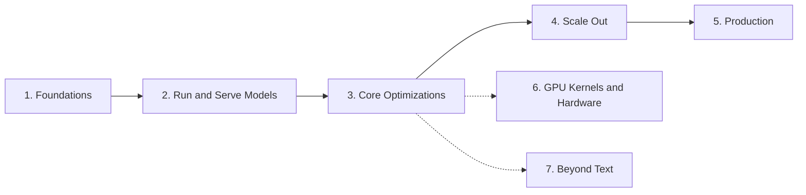

# Awesome Inference Engineering 

> Inference engineering is the practice of running trained models in production so that they are fast, cheap and reliable, from GPU kernels to serving fleets.

This list is a roadmap. Work through the stages in order. Each stage has a goal, the best resources for it, and a checkpoint so you know when you're ready to move on. Stages 1 to 5 are the core path. Stages 6 and 7 are specializations you can take in either order after Stage 3.

The focus is on engineering: the tools, systems and operational practice of serving models. For a complete index of inference research papers, see [Awesome LLM Inference](https://github.com/xlite-dev/Awesome-LLM-Inference).

## Contents

- [Stage 1: Foundations](#stage-1-foundations)
- [Stage 2: Run and Serve Models](#stage-2-run-and-serve-models)
- [Stage 3: Core Optimizations](#stage-3-core-optimizations)
  - [Attention and KV Cache](#attention-and-kv-cache)
  - [Batching and Scheduling](#batching-and-scheduling)
  - [Speculative Decoding](#speculative-decoding)
  - [Quantization](#quantization)
  - [Structured Output](#structured-output)
- [Stage 4: Scale Out](#stage-4-scale-out)
- [Stage 5: Production](#stage-5-production)
  - [Deployment and Orchestration](#deployment-and-orchestration)
  - [Autoscaling and Cold Starts](#autoscaling-and-cold-starts)
  - [Gateways and Routing](#gateways-and-routing)
  - [Observability and Profiling](#observability-and-profiling)
  - [Benchmarking](#benchmarking)
  - [Capacity and Cost](#capacity-and-cost)
- [Stage 6: GPU Kernels and Hardware](#stage-6-gpu-kernels-and-hardware)
- [Stage 7: Beyond Text](#stage-7-beyond-text)
- [Courses and Books](#courses-and-books)

## Stage 1: Foundations

**Goal:** Understand what happens when a model generates a token, and why inference is usually limited by memory bandwidth rather than compute.

- [How LLM Inference Works](https://arpitbhayani.me/blogs/how-llm-inference-works/) - Walkthrough from prompt to response, including tokenization and autoregressive decoding.
- [Transformer Inference Arithmetic](https://kipp.ly/p/transformer-inference-arithmetic) - Back-of-the-envelope compute and memory math for transformer inference.
- [LLM Inference Performance Engineering: Best Practices](https://www.databricks.com/blog/llm-inference-performance-engineering-best-practices) - Defines TTFT, TPOT, throughput and the trade-offs between them.
- [Making Deep Learning Go Brrrr From First Principles](https://horace.io/brrr_intro.html) - Compute-bound, memory-bound and overhead-bound regimes explained.
- [How to Think About GPUs](https://jax-ml.github.io/scaling-book/gpus/) - How GPUs work, how they are networked and what it means for LLMs.
- [Mastering LLM Techniques: Inference Optimization](https://developer.nvidia.com/blog/mastering-llm-techniques-inference-optimization/) - Overview of batching, KV cache, parallelism and quantization.
- [Large Transformer Model Inference Optimization](https://lilianweng.github.io/posts/2023-01-10-inference-optimization/) - Survey of distillation, quantization, pruning and sparsity for inference.

**Try it:** Pick an open model such as Llama 3.1 8B. From its config, calculate the weight memory and the KV cache per token in BF16, then work out how many 8K-token requests fit on one 80 GB GPU.

**Checkpoint:** You can explain the difference between prefill and decode, estimate memory needs for any model, and say why decode is memory-bound.

## Stage 2: Run and Serve Models

**Goal:** Run models locally and behind a server, and learn what an inference engine does internally.

### Local and Edge

- [Ollama](https://github.com/ollama/ollama) - Local model runner with a model library and an OpenAI-compatible API.
- [llama.cpp](https://github.com/ggml-org/llama.cpp) - LLM inference in C/C++ across CPUs, GPUs and Apple Silicon, with the GGUF format.
- [MLX LM](https://github.com/ml-explore/mlx-lm) - LLM inference and fine-tuning on Apple Silicon with MLX.
- [MLC LLM](https://github.com/mlc-ai/mlc-llm) - Compiler-based deployment of LLMs to GPUs, mobile and browsers.
- [mistral.rs](https://github.com/EricLBuehler/mistral.rs) - LLM inference engine written in Rust.
- [ExecuTorch](https://github.com/pytorch/executorch) - On-device inference runtime for PyTorch models.

### Server Engines

- [vLLM](https://github.com/vllm-project/vllm) - High-throughput serving engine built around PagedAttention and continuous batching.
- [SGLang](https://github.com/sgl-project/sglang) - Serving framework with RadixAttention prefix caching and a structured generation frontend.
- [TensorRT-LLM](https://github.com/NVIDIA/TensorRT-LLM) - NVIDIA's optimized LLM inference library for its GPUs.
- [LMDeploy](https://github.com/InternLM/lmdeploy) - Toolkit for compressing, deploying and serving LLMs with the TurboMind engine.

### General Model Serving

- [Triton Inference Server](https://github.com/triton-inference-server/server) - Multi-framework model server with dynamic batching and model ensembles.
- [ONNX Runtime](https://github.com/microsoft/onnxruntime) - Cross-platform inference runtime for ONNX models.
- [OpenVINO](https://github.com/openvinotoolkit/openvino) - Intel's toolkit for optimizing and running models on CPUs, GPUs and NPUs.
- [CTranslate2](https://github.com/OpenNMT/CTranslate2) - Fast inference engine for transformer models on CPU and GPU.

### Inside an Engine

- [Understanding LLM Inference Engines: Inside Nano-vLLM](https://neutree.ai/blog/nano-vllm-part-1) - Guided walkthrough of scheduling, batching and memory management in nano-vllm.
- [nano-vllm](https://github.com/GeeeekExplorer/nano-vllm) - Lightweight vLLM reimplementation in about 1,200 lines of Python.
- [mini-sglang](https://github.com/sgl-project/mini-sglang) - Compact reimplementation of SGLang for studying engine design.
- [Inside vLLM: Anatomy of a High-Throughput LLM Inference System](https://vllm.ai/blog/2025-09-05-anatomy-of-vllm) - Tour of a production engine's scheduler, KV cache manager and model runner.
- [Defeating Nondeterminism in LLM Inference](https://thinkingmachines.ai/blog/defeating-nondeterminism-in-llm-inference/) - Why identical requests give different outputs and how batch-invariant kernels fix it.

**Try it:** Serve the same model with Ollama and with vLLM. Send requests at concurrency 1, 8, 32 and 128, and record time to first token, time per output token and total throughput for each.

**Checkpoint:** You can explain why the two engines behave differently under load, and describe the path of a request through vLLM.

## Stage 3: Core Optimizations

**Goal:** Learn the techniques every modern engine uses, why each works, and what it trades away.

### Attention and KV Cache

- [Paged Attention from First Principles](https://hamzaelshafie.bearblog.dev/paged-attention-from-first-principles-a-view-inside-vllm/) - Builds up PagedAttention from the memory problem it solves.
- [Efficient Memory Management for LLM Serving with PagedAttention](https://arxiv.org/abs/2309.06180) - Paged KV cache allocation; the vLLM paper (SOSP 2023).
- [FlashAttention](https://arxiv.org/abs/2205.14135) - IO-aware exact attention; FlashAttention-2 and -3 extend it to better parallelism and Hopper GPUs (2022).
- [GQA: Training Generalized Multi-Query Transformer Models](https://arxiv.org/abs/2305.13245) - Grouped-query attention to shrink the KV cache (2023).
- [DeepSeek-V2](https://arxiv.org/abs/2405.04434) - Introduces Multi-head Latent Attention (MLA) for compressed KV cache (2024).
- [Prompt Caching](https://ngrok.com/blog/prompt-caching) - How prompt caching works and when it pays off.
- [KV-Cache Wins You Can See](https://llm-d.ai/blog/kvcache-wins-you-can-see) - From prefix caching in vLLM to cache-aware routing in llm-d.
- [LMCache](https://github.com/LMCache/LMCache) - KV cache layer for reuse across requests, engines and storage tiers.
- [kvcached](https://github.com/ovg-project/kvcached) - Virtualized, elastic KV cache for sharing GPUs between models.

### Batching and Scheduling

- [How Continuous Batching Enables 23x Throughput in LLM Inference](https://www.anyscale.com/blog/continuous-batching-llm-inference) - Static versus continuous batching, explained with benchmarks.
- [Orca: A Distributed Serving System for Transformer-Based Generative Models](https://www.usenix.org/conference/osdi22/presentation/yu) - Iteration-level scheduling, the origin of continuous batching (OSDI 2022).
- [Sarathi-Serve](https://arxiv.org/abs/2403.02310) - Chunked prefill to balance throughput and latency (OSDI 2024).

### Speculative Decoding

- [Fast Inference from Transformers via Speculative Decoding](https://arxiv.org/abs/2211.17192) - The original draft-and-verify method (ICML 2023).
- [Medusa](https://arxiv.org/abs/2401.10774) - Extra decoding heads that propose multiple tokens per step (ICML 2024).
- [EAGLE](https://github.com/SafeAILab/EAGLE) - Feature-level drafting; EAGLE-3 is widely supported in engines.
- [SuffixDecoding](https://suffix-decoding.github.io/) - Model-free drafting with suffix trees for agentic workloads (NeurIPS 2025).
- [Speculators](https://github.com/vllm-project/speculators) - Library for training speculative decoding draft models that run in vLLM.
- [Spec-Bench](https://github.com/hemingkx/Spec-Bench) - Unified benchmark for speculative decoding methods.

### Quantization

- [A Visual Guide to Quantization](https://newsletter.maartengrootendorst.com/p/a-visual-guide-to-quantization) - Illustrated introduction to number formats and quantization methods.
- [GPTQ](https://arxiv.org/abs/2210.17323) - One-shot post-training weight quantization using second-order information (2022).
- [SmoothQuant](https://arxiv.org/abs/2211.10438) - Migrates activation outliers into weights for W8A8 inference (2022).
- [AWQ](https://arxiv.org/abs/2306.00978) - Activation-aware weight quantization for low-bit LLMs (MLSys 2024).
- [Optimizing Inference with NVFP4 KV Cache](https://developer.nvidia.com/blog/optimizing-inference-for-long-context-and-large-batch-sizes-with-nvfp4-kv-cache/) - Quantizing the KV cache to FP4 for long contexts and large batches.
- [LLM Compressor](https://github.com/vllm-project/llm-compressor) - Quantization and sparsity recipes that produce vLLM-ready checkpoints.
- [TorchAO](https://github.com/pytorch/ao) - PyTorch-native quantization and sparsity for training and inference.
- [GPTQModel](https://github.com/ModelCloud/GPTQModel) - Maintained GPTQ toolkit with multi-backend kernels.
- [AutoRound](https://github.com/intel/auto-round) - Signed-gradient weight rounding for low-bit quantization.
- [bitsandbytes](https://github.com/bitsandbytes-foundation/bitsandbytes) - 8-bit and 4-bit quantization for PyTorch.

### Structured Output

- [XGrammar](https://github.com/mlc-ai/xgrammar) - Grammar-constrained decoding engine used by vLLM and SGLang.
- [Outlines](https://github.com/dottxt-ai/outlines) - Structured generation with JSON Schema, regex and grammars.
- [LLGuidance](https://github.com/guidance-ai/llguidance) - Fast constrained decoding library in Rust.
- [Guided Decoding Performance on vLLM and SGLang](https://blog.squeezebits.com/guided-decoding-performance-vllm-sglang) - Benchmark of XGrammar and LLGuidance backends across engines.
- [Tool Calling in Inference](https://www.baseten.co/blog/tool-calling-in-inference/) - Why tool calling quality varies across providers and how to make it reliable.

**Try it:** Starting from your Stage 2 baseline, turn on one technique at a time: prefix caching with a shared system prompt, an FP8 or INT4 quantized checkpoint, and a speculative decoding draft model. Measure latency, throughput and accuracy for each.

**Checkpoint:** You can say which technique helps which workload, and what each one costs in memory, accuracy or complexity.

## Stage 4: Scale Out

**Goal:** Serve models that do not fit on one GPU, and serve them across many GPUs efficiently.

- [The Ultra-Scale Playbook](https://huggingface.co/spaces/nanotron/ultrascale-playbook) - Interactive guide to data, tensor, context, pipeline and expert parallelism; written for training, but the concepts carry over to serving.
- [Visualizing Parallelism in Transformer](https://ailzhang.github.io/posts/distributed-compute-in-transformer/) - Diagrams of how parallelism strategies shard a transformer.
- [How To Scale Your Model: Inference](https://jax-ml.github.io/scaling-book/inference/) - Rigorous treatment of latency, throughput and sharding for transformer inference.
- [DistServe](https://arxiv.org/abs/2401.09670) - Disaggregates prefill and decode onto separate GPUs to meet goodput targets (OSDI 2024).
- [Mooncake: A KVCache-centric Disaggregated Architecture for LLM Serving](https://arxiv.org/abs/2407.00079) - Production disaggregated serving at Moonshot AI; a version appeared at FAST 2025 (2024).
- [Disaggregated Inference: 18 Months Later](https://haoailab.com/blogs/distserve-retro/) - How prefill/decode disaggregation became standard across engines.
- [Disaggregated Inference at Scale with PyTorch and vLLM](https://pytorch.org/blog/disaggregated-inference-at-scale-with-pytorch-vllm/) - Prefill/decode disaggregation in production.
- [The vLLM MoE Playbook](https://rocm.blogs.amd.com/software-tools-optimization/vllm-moe-guide/README.html) - Combining TP, DP, PP and EP for MoE models in vLLM.
- [vLLM Large Scale Serving: DeepSeek with Wide-EP](https://vllm.ai/blog/2025-12-17-large-scale-serving) - Wide expert parallelism, dual-batch overlap and expert load balancing for DeepSeek on multi-node H200 clusters.
- [NVIDIA Dynamo](https://github.com/ai-dynamo/dynamo) - Datacenter-scale serving framework with disaggregation and KV-aware routing.
- [llm-d](https://github.com/llm-d/llm-d) - Kubernetes-native distributed inference built on vLLM.
- [Mooncake](https://github.com/kvcache-ai/Mooncake) - KV-cache-centric disaggregated serving platform from Moonshot AI.
- [NIXL](https://github.com/ai-dynamo/nixl) - Point-to-point transfer library for moving KV cache between nodes.
- [DeepEP](https://github.com/deepseek-ai/DeepEP) - Communication library for expert-parallel MoE dispatch and combine.
- [NCCL](https://github.com/NVIDIA/nccl) - NVIDIA's collective communication library.
- [UCCL](https://github.com/uccl-project/uccl) - GPU communication library for collectives, P2P and expert parallelism.

**Try it:** Serve a model too large for one GPU with tensor parallelism, then compare it with pipeline parallelism on the same GPUs. If you have the hardware, try a prefill/decode split with llm-d or Dynamo.

**Checkpoint:** You can choose a parallelism strategy for a given model and GPU count, and explain when prefill/decode disaggregation is worth it.

## Stage 5: Production

**Goal:** Run inference as a reliable service: deploy it, scale it, route traffic, watch it, prove its performance and know what it costs.

### Deployment and Orchestration

- [KServe](https://github.com/kserve/kserve) - Kubernetes model serving platform with autoscaling and inference graphs.
- [vLLM Production Stack](https://github.com/vllm-project/production-stack) - Reference Kubernetes stack for vLLM with routing and observability.
- [AIBrix](https://github.com/vllm-project/aibrix) - Control plane for LLM serving on Kubernetes.
- [LeaderWorkerSet](https://github.com/kubernetes-sigs/lws) - Kubernetes API for multi-host inference groups.
- [NVIDIA GPU Operator](https://github.com/NVIDIA/gpu-operator) - Manages GPU drivers, runtime and device plugins on Kubernetes.
- [HAMi](https://github.com/Project-HAMi/HAMi) - GPU sharing and virtualization middleware for Kubernetes.
- [Ray Serve](https://docs.ray.io/en/latest/serve/index.html) - Scalable model serving on Ray with LLM-specific APIs.
- [BentoML](https://github.com/bentoml/BentoML) - Framework for packaging and serving models as APIs.
- [SkyPilot](https://github.com/skypilot-org/skypilot) - Runs and serves AI workloads across clouds and Kubernetes.
- [dstack](https://github.com/dstackai/dstack) - Orchestration layer for training and inference across GPU clouds, Kubernetes and bare metal.

### Autoscaling and Cold Starts

- [KEDA](https://github.com/kedacore/keda) - Event-driven autoscaling for Kubernetes, often driven by queue depth or engine metrics.
- [Model Streamer](https://github.com/dsx-ai-factory/model-streamer) - Streams SafeTensors weights to GPU memory concurrently to cut model load time.
- [llm-d Architecture](https://llm-d.ai/docs/architecture) - How a distributed serving stack splits scheduling, routing and model servers.

### Gateways and Routing

- [Gateway API Inference Extension](https://github.com/kubernetes-sigs/gateway-api-inference-extension) - Kubernetes Gateway API extension for model-aware, KV-cache-aware routing.
- [Agent Router](https://github.com/theagentrouter/agent-router) - Envoy-based control plane for AI and agent traffic, formerly Envoy AI Gateway.
- [vLLM Semantic Router](https://github.com/vllm-project/semantic-router) - Decision layer that picks a model for each request based on its content.
- [LiteLLM](https://github.com/BerriAI/litellm) - OpenAI-compatible proxy for many providers with budgets and fallbacks.
- [Portkey Gateway](https://github.com/Portkey-AI/gateway) - Lightweight AI gateway with retries, fallbacks and load balancing.

### Observability and Profiling

- [DCGM Exporter](https://github.com/NVIDIA/dcgm-exporter) - Exports NVIDIA GPU metrics to Prometheus.
- [Nsight Systems](https://developer.nvidia.com/nsight-systems) - System-wide profiler for CPU/GPU timelines.
- [PyTorch Profiler](https://docs.pytorch.org/docs/stable/profiler.html) - Operator- and kernel-level profiling for PyTorch workloads.
- [NVTX](https://github.com/NVIDIA/NVTX) - Annotations to label code ranges in Nsight timelines.
- [vLLM Metrics](https://docs.vllm.ai/en/latest/design/metrics.html) - Design of vLLM's Prometheus metrics, such as queue time, KV cache usage and request latency.
- [OpenTelemetry GenAI Semantic Conventions](https://github.com/open-telemetry/semantic-conventions-genai) - Standard attribute names for tracing model calls.
- [Langfuse](https://github.com/langfuse/langfuse) - Request-level tracing and analytics for LLM applications.
- [Host Overhead is Killing Your Inference Efficiency](https://modal.com/blog/host-overhead-inference-efficiency) - Finding and removing CPU-side bottlenecks that idle the GPU.
- [The GPU Observability Gap](https://eunomia.dev/blog/2025/10/14/the-gpu-observability-gap-why-we-need-ebpf-on-gpu-devices/) - Why eBPF-style visibility is needed inside GPU workloads.

### Benchmarking

- [LLM Inference Benchmarking: Fundamental Concepts](https://developer.nvidia.com/blog/llm-benchmarking-fundamental-concepts/) - What TTFT, ITL and throughput actually measure, and common pitfalls.
- [AIPerf](https://github.com/ai-dynamo/aiperf) - Load generator for measuring inference latency and throughput.
- [GuideLLM](https://github.com/vllm-project/guidellm) - Evaluates LLM deployments under realistic traffic patterns.
- [inference-perf](https://github.com/kubernetes-sigs/inference-perf) - Kubernetes SIG tool for benchmarking GenAI inference servers.
- [InferenceX](https://github.com/SemiAnalysisAI/InferenceX) - Continuously updated open benchmarks across accelerators and engines.
- [MLPerf Inference](https://github.com/mlcommons/inference) - Industry-standard inference benchmark suite.
- [Artificial Analysis Hardware Benchmarks](https://artificialanalysis.ai/hardware-inference-stack/) - Independent comparisons of accelerator systems for LLM serving.
- [LM Evaluation Harness](https://github.com/EleutherAI/lm-evaluation-harness) - Checks that optimizations like quantization have not hurt model quality.

### Capacity and Cost

- [Vidur](https://github.com/microsoft/vidur) - Simulator for exploring LLM serving configurations without GPUs.
- [GPU (In)efficiency in AI Workloads](https://www.anyscale.com/blog/gpu-in-efficiency-in-ai-workloads) - Why production GPUs sit underused and what to do about it.
- [The Next 1000x Cost Saving of LLM](https://ralphmao.github.io/token-cost/) - Where past per-token cost reductions came from, and where the next 1000x could come from.

**Try it:** Deploy a model on Kubernetes behind a gateway. Set latency targets, for example p95 time to first token under 500 ms. Build dashboards for GPU and request metrics, then load test until you break the targets and find what saturates first.

**Checkpoint:** You can state how many requests per second one replica serves within its targets, what it costs per million tokens, and what alerts you when it degrades.

## Stage 6: GPU Kernels and Hardware

**Goal:** Understand and write the kernels that engines are built on, and how hardware shapes them.

### Reading

- [How to Optimize a CUDA Matmul Kernel for cuBLAS-like Performance](https://siboehm.com/articles/22/CUDA-MMM) - Step-by-step matmul optimization from naive to near-cuBLAS.
- [Inside NVIDIA GPUs: Anatomy of High-Performance Matmul Kernels](https://www.aleksagordic.com/blog/matmul) - From GPU architecture and PTX/SASS to Hopper tensor core pipelines.
- [Outperforming cuBLAS on H100: A Worklog](https://cudaforfun.substack.com/p/outperforming-cublas-on-h100-a-worklog) - Hopper-specific matmul optimizations, step by step.
- [CUTLASS Tutorial: Fast Matrix-Multiplication with WGMMA on Hopper](https://research.colfax-intl.com/cutlass-tutorial-wgmma-hopper/) - Writing Hopper GEMMs with CUTLASS and WGMMA.
- [CUDA Programming Guide](https://docs.nvidia.com/cuda/cuda-programming-guide/) - NVIDIA's official reference for the CUDA programming model.
- [Domain-Specific Architectures for AI Inference](https://fleetwood.dev/posts/domain-specific-architectures) - Why AI inference accelerators look the way they do.
- [A Close Look at SRAM for Inference](https://www.viksnewsletter.com/p/a-close-look-at-sram-for-inference) - SRAM versus HBM trade-offs for inference chips; the cost section is for paid subscribers.

### Libraries and Languages

- [Triton](https://github.com/triton-lang/triton) - Python-based language and compiler for writing GPU kernels.
- [CUTLASS](https://github.com/NVIDIA/cutlass) - CUDA C++ and Python templates for high-performance GEMM and related kernels.
- [FlashInfer](https://github.com/flashinfer-ai/flashinfer) - Kernel library for LLM serving: attention, GEMM, sampling and MoE.
- [FlashAttention](https://github.com/Dao-AILab/flash-attention) - Reference implementation of the FlashAttention kernels.
- [FlashMLA](https://github.com/deepseek-ai/FlashMLA) - Decoding kernels for Multi-head Latent Attention.
- [ThunderKittens](https://github.com/HazyResearch/ThunderKittens) - Tile primitives for writing fast deep learning kernels.
- [TileLang](https://github.com/tile-ai/tilelang) - Tile-level DSL for writing high-performance kernels.
- [Helion](https://github.com/pytorch/helion) - Python-embedded DSL from PyTorch for authoring ML kernels.
- [DeepGEMM](https://github.com/deepseek-ai/DeepGEMM) - Compact tensor core kernel library for FP8, FP4 and BF16 GEMMs and fused MoE.
- [FlashInfer-Bench](https://bench.flashinfer.ai/) - Benchmark platform for LLM serving kernels.

### Beyond NVIDIA

- [ROCm](https://rocm.docs.amd.com/) - Documentation for AMD's open software stack for GPU computing.
- [AITER](https://github.com/ROCm/aiter) - AMD's library of inference operators for ROCm.
- [MLX](https://github.com/ml-explore/mlx) - Array framework for machine learning on Apple Silicon.

**Try it:** Write a fused softmax or matmul kernel in Triton, profile it with Nsight Compute, and compare its achieved bandwidth or FLOPS with the GPU's peak.

**Checkpoint:** You can read a kernel profile and explain how close a kernel gets to the hardware's limits, and why.

## Stage 7: Beyond Text

**Goal:** Apply the same ideas to image, video, speech and embedding workloads.

- [vLLM-Omni](https://github.com/vllm-project/vllm-omni) - vLLM extension for serving omni-modality models.
- [SGLang Diffusion](https://www.lmsys.org/blog/2025-11-07-sglang-diffusion/) - SGLang's serving optimizations applied to image and video generation.
- [xDiT](https://github.com/xdit-project/xDiT) - Parallel inference engine for diffusion transformers.
- [Diffusers](https://github.com/huggingface/diffusers) - Diffusion pipelines with attention backends and caching options.
- [Optimizing Diffusion for Production-Ready Speeds](https://a-r-r-o-w.github.io/blog/3_blossom/00001_productionizing_diffusion-1/) - Step-by-step FLUX inference speedups with torch.compile, QKV fusion and CUDA Graphs, with benchmarks.
- [faster-whisper](https://github.com/SYSTRAN/faster-whisper) - Whisper speech recognition on CTranslate2.
- [whisper.cpp](https://github.com/ggml-org/whisper.cpp) - Portable Whisper inference in C/C++.
- [Text Embeddings Inference](https://github.com/huggingface/text-embeddings-inference) - Serving engine for embedding and reranker models.

**Try it:** Serve a speech-to-text model and an image generation model, and measure latency per request at increasing concurrency.

**Checkpoint:** You can explain how serving a diffusion or speech model differs from serving an LLM, and which Stage 3 techniques still apply.

## Courses and Books

Use these alongside any stage.

- [Inference Engineering](https://www.baseten.co/inference-engineering/book/) - Philip Kiely's book on serving generative AI in production, from GPUs to Kubernetes; free to read online.
- [GPU MODE Lectures](https://github.com/gpu-mode/lectures) - Community lecture series on GPU programming and ML systems.
- [MIT 6.5940: TinyML and Efficient Deep Learning Computing](https://hanlab.mit.edu/courses/2024-fall-65940) - Course on quantization, pruning, distillation and efficient inference.
- [ML Hardware and Systems (Cornell ECE 5545)](https://abdelfattah-class.github.io/ece5545/) - Course connecting ML algorithms to hardware and systems.
- [How To Scale Your Model](https://jax-ml.github.io/scaling-book/) - Book on TPU/GPU architecture, communication and parallelism for LLMs.
- [AI Infrastructure Book](https://github.com/bojieli/ai-infra-book) - Quantitative treatment of LLM inference and training system design (in Chinese).
- [Build an LLM from Scratch with MAX](https://llm.modular.com/) - Interactive tutorial that builds an LLM with Modular's MAX.

## Related Lists

- [AI Inference Resources](https://github.com/aerlabsAI/ai-inference-resources#readme) - Tiered learning guide to AI inference engineering.
- [GPU Performance Engineering Resources](https://github.com/wafer-ai/gpu-perf-engineering-resources#readme) - Curated path from GPU fundamentals to production inference.
- [Awesome LLM Inference](https://github.com/xlite-dev/Awesome-LLM-Inference#readme) - Papers and code on LLM inference.
- [Awesome LLM Inference Engine](https://github.com/sihyeong/Awesome-LLM-Inference-Engine#readme) - Survey of LLM inference engines.
- [Awesome vLLM Plugins](https://github.com/BudEcosystem/Awesome-vLLM-plugins#readme) - Plugins that extend vLLM.

## Contributing

Contributions are welcome. Read the [contribution guidelines](contributing.md) first.
